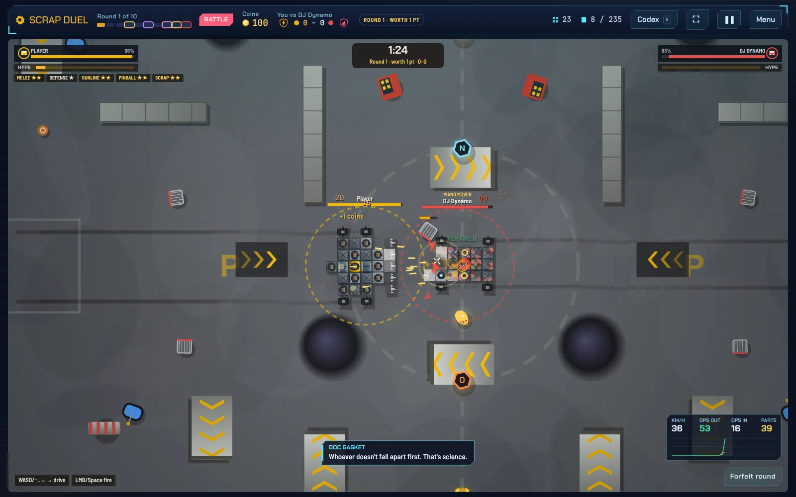
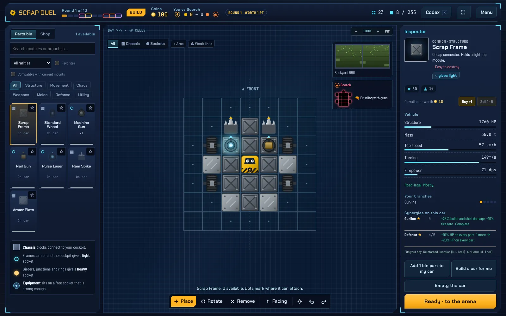
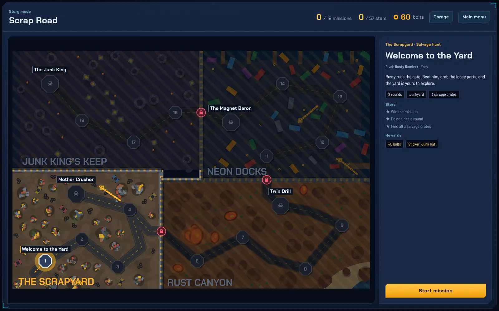
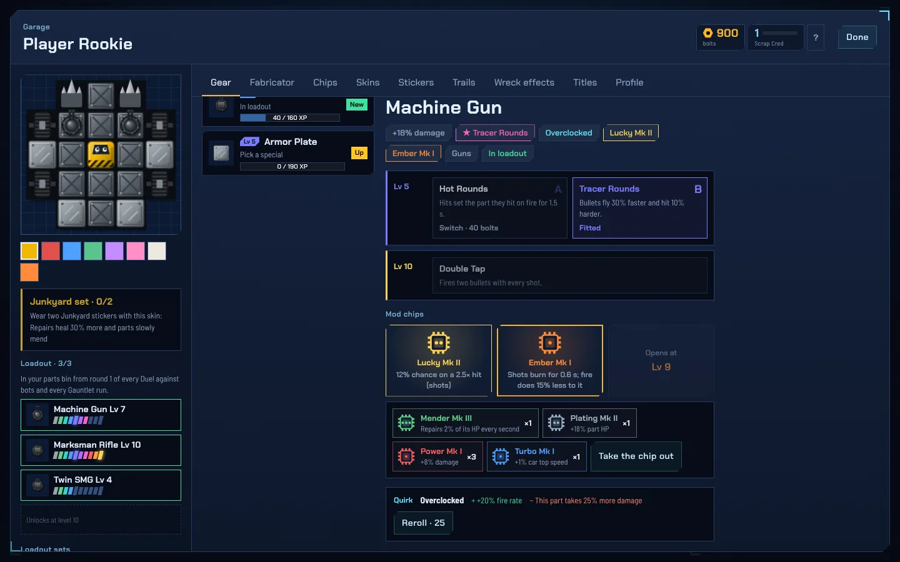

# Scrap Duel

Build a battle car from scrap, then fight a bot, a boss or a friend. A desktop game for Windows.

**[Download for Windows](https://scrap-duel.netlify.app)** · [All releases](https://github.com/mikeey77/scrap-duel/releases) · [Changelog](CHANGELOG.md)



## The game

Every round of a duel has three parts: **draft** a part from three cards, **build** it onto your car on a grid, and **fight** in an arena. Parts break off as you take hits; the last car with a cockpit wins the round.

| Mode            | What it is                                                                    |
| --------------- | ----------------------------------------------------------------------------- |
| Scrap Road      | The story: 19 missions in four regions, each region ending with a boss car    |
| Duel            | Draft, build and fight a bot on Easy, Normal or Hard, over 5, 10 or 25 rounds |
| Blueprint Brawl | No drafting. Bring one car worth up to 700 coins. Against a bot or online     |
| Scrap Gauntlet  | Endless waves with three hearts; a boss every fifth wave drops a relic        |
| Online          | Duel or Brawl a friend with a 4-letter room code, peer to peer                |
| Sandbox         | Every part, 99 of each, to build and test anything                            |

Between matches, **Garage HQ** holds the gear you have found: pick a loadout, upgrade parts to a level 5 Masterwork, build new gear in the Fabricator, and dress your car with skins, stickers, trails and wreck effects.

| Garage                                 | Scrap Road                                | Garage HQ                                   |
| -------------------------------------- | ----------------------------------------- | ------------------------------------------- |
|  |  |  |

### Controls

- **Drive** with WASD or the arrow keys, **aim** with the mouse, **fire** with left click or Space.
- **Moving parts** (hinges, rotators, rams) are on keys 1–9; set them with the Keys tool in the garage.
- **Quick chat** online: T, then 1–4.
- **Garage**: click or drag to place, right click to remove, R to turn the next part, T to rotate a placed part, M to mirror, Ctrl+Z / Ctrl+Y to undo and redo.
- F11 for fullscreen, Esc for the pause menu.

## Project layout

```
src/            the game: index.html, css/ and js/ split by feature, manifest.json sets the load order
desktop/        the Electron shell (window, app:// protocol, saved window size, preload bridge)
site/           build output the app loads (only the icons are checked in)
tests/          regression suite
web/            the download page that Netlify publishes
CHANGELOG.md    release notes; the newest section also appears on the download page
```

All scripts in `src/js` share one scope and are bundled in the order of `src/manifest.json`. Edit files in `src/`; `site/index.html` is generated.

## Development

Needs Node.js 22.

```sh
npm install
npm start        # build and open the game window
npm test         # build, then run the regression suite
npm run web      # build the download page into web/dist
npm run format   # Prettier
```

To play in a browser while developing, build and serve `site/` (for example `python -m http.server 8765 --directory site`). Online play needs an internet connection for the room code exchange (PeerJS); the match itself is peer to peer.

## Releasing a new version

1. Bump `version` in `package.json`.
2. Add a section for it at the top of `CHANGELOG.md`.
3. Push to `main`.

The **Release** workflow then builds `ScrapDuel-Setup.exe` and `ScrapDuel-Windows.zip` on Windows and publishes them as GitHub Release `vX.Y.Z` with the changelog section as notes. Netlify rebuilds the download page, whose buttons always point at the newest release (`/download` and `/download/zip`).

`npm run dist:win` builds the same files locally on Windows. `npm run dist:win-local` works on Linux and macOS but skips the exe icon and metadata.

Online play only works between players on the same version (the network protocol number is checked when you join).
